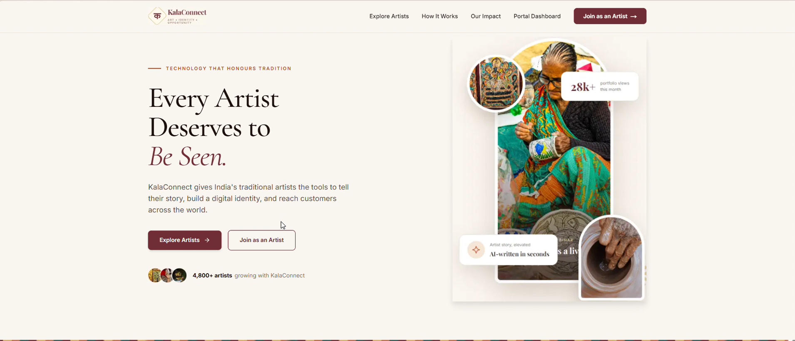
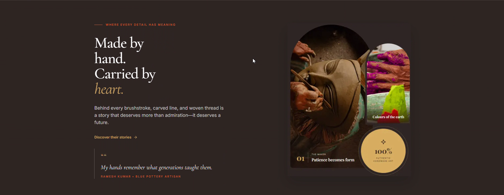
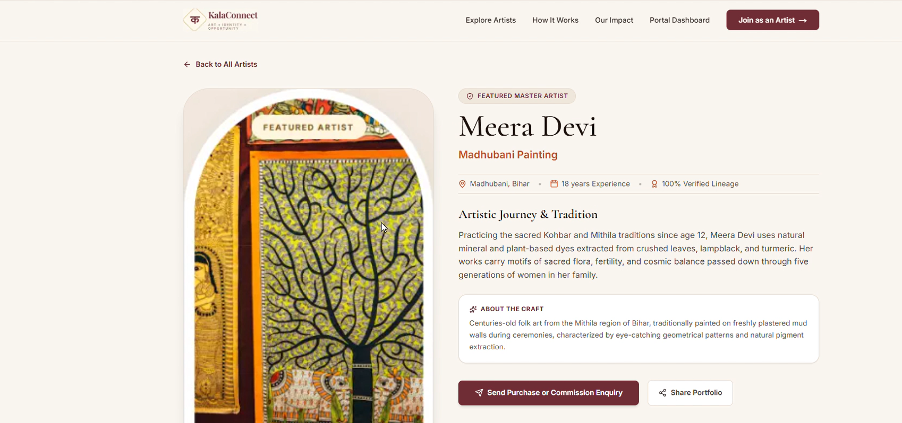
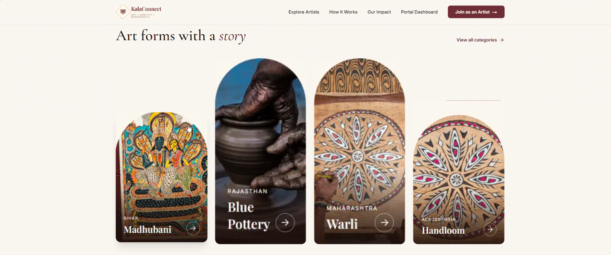

# KalaConnect – Art, Identity & Opportunity

**Where Tradition Meets Tomorrow**

KalaConnect is a digital platform that empowers traditional Indian artists by helping them showcase their artwork, build their digital identity, and connect with potential buyers and art enthusiasts.

---

## 1. Project Overview

Traditional Indian art represents generations of creativity, cultural knowledge, and craftsmanship. However, many traditional artists face difficulties reaching wider audiences and establishing an online presence.

**KalaConnect** bridges this gap through a digital platform where artists can register, create portfolios, upload artwork, share their creative stories, and connect directly with interested visitors.

The platform brings traditional Indian art and modern technology together to make artists and their work more visible and accessible.

**Our Vision:** To connect India's traditional artists with digital opportunities while celebrating and promoting the country's rich artistic heritage.

## 2. Problem Statement

Traditional Indian artists face several challenges in today's digital environment:

- **Limited Digital Visibility:** Many artists lack an effective online platform to showcase their work.
- **Limited Market Access:** Artists often struggle to connect with potential customers and art enthusiasts.
- **Marketing Difficulties:** Promoting artwork and communicating its cultural significance can be challenging.
- **Lack of Digital Identity:** Artists need a dedicated space to present their profiles, skills, and creations.
- **Communication Barriers:** Connecting with interested buyers and managing artwork enquiries can be difficult.

KalaConnect addresses these challenges by providing artists with digital portfolios, artwork storytelling, discovery tools, and direct communication opportunities.

## 3. Key Features

### 3.1 Artist Registration and Authentication
- Artist account registration.
- Secure login and credential verification.
- Password hashing.
- Automatic artist profile slug generation.
- Session-based authentication.

### 3.2 Artist Dashboard
- Dedicated artist dashboard.
- Overview of total artworks.
- Portfolio view statistics.
- Unread enquiry counter.
- Artist profile and artwork management.

### 3.3 Artwork Upload and Management
- Upload artwork images.
- Add artwork information and metadata.
- Preview uploaded artwork.
- Manage existing artwork.
- Delete artwork.

### 3.4 AI-Powered Artwork Story Generator
- Generate culturally inspired artwork descriptions and stories.
- Help artists communicate the inspiration and heritage behind their creations.
- Review and edit generated content before publishing.

### 3.5 Digital Artist Portfolios
- Dedicated public portfolio for every artist.
- Display artist biography and art forms.
- Showcase uploaded artworks.
- Display artwork information.
- Shareable portfolio URLs.
- Portfolio visit counter.

### 3.6 Public Artist Directory and Discovery
- Browse registered artists.
- Search artists.
- Filter artists by traditional art categories.
- Explore art forms such as Madhubani, Blue Pottery, Warli, Handloom, and Kutch crafts.

### 3.7 Direct Artist Connection
- Artwork enquiry functionality.
- Purchase and custom commission enquiries.
- Receive and manage enquiries through the artist dashboard.
- WhatsApp and email contact options.

### 3.8 QR Code Sharing
- Generate printable QR codes for artist portfolios.
- Allow visitors to access an artist's public portfolio by scanning the QR code.

### 3.9 Digital Exhibition Viewing
- Public virtual exhibition pages.
- Exhibition cover and description.
- Curatorial statement.
- Exhibition artwork display.
- Artwork title, category, price, medium, dimensions, and creation year.
- Artwork thumbnail and previous/next navigation.
- Direct exhibition artwork enquiries.
- Artist portfolio access from the exhibition.

### 3.10 Cultural Splash Screen
- KalaConnect branded opening screen.
- Indian art and heritage-inspired visual design.
- Animated logo and brand introduction.
- Skip option and transition to the homepage.

## 4. Technology Stack

The following stack is identified from the project's package configuration and supporting project files.

| Layer | Technology |
|---|---|
| Frontend Framework | Next.js 16.4.5 |
| UI Library | React 19.3.1 |
| Programming Language | TypeScript 7.0.2 |
| Styling | Tailwind CSS 3.4.19 |
| CSS Processing | PostCSS 8.5.32 |
| CSS Compatibility | Autoprefixer 10.6.2 |
| Backend | Next.js API Routes / Node.js |
| Authentication | Custom authentication with Node.js scrypt password hashing and session cookies |
| Database Integration | Supabase JavaScript Client 2.118.0 (optional integration documented) |
| Icon Library | Lucide React 1.67.0 |
| Package Manager | npm |
| Version Control | Git and GitHub |
| Deployment Option | Vercel |

**Additional implementation details:**
- Artwork uploads are documented as multipart uploads to the application's `/public/uploads/` directory.
- The project includes an optional Supabase integration for PostgreSQL and storage.
- The AI story-generation API is implemented, but the AI provider is not identified in the available project configuration.

## 5. System Architecture

KalaConnect uses a Next.js full-stack architecture, with frontend pages, backend API routes, authentication, artwork management, and supporting services.

### High-Level Architecture

```text
                  USERS
                    |
          +---------+---------+
          |                   |
       ARTISTS              VISITORS
          |                   |
          +---------+---------+
                    |
              NEXT.JS APP
                    |
          +---------+---------+
          |                   |
       FRONTEND            API ROUTES
       (React)             (Next.js)
          |                   |
          |         +---------+----------+
          |         |         |          |
          |       AUTH     ARTWORK    ENQUIRY
          |      SERVICES  SERVICES   SERVICES
          |         |         |          |
          +---------+---------+----------+
                    |
             APPLICATION DATA
                    |
          +---------+----------+
          |                    |
       FILE STORAGE       OPTIONAL
       /public/uploads/   SUPABASE
          |                    |
          +---------+----------+
                    |
              KALACONNECT
                PLATFORM
```

### Main Modules

1. **Artist Management:** Registration, authentication, and artist profiles.
2. **Artwork Management:** Uploading, editing, displaying, and deleting artworks.
3. **AI Story Generation:** Generating artwork descriptions and stories.
4. **Portfolio Management:** Public artist pages and portfolio statistics.
5. **Artist Discovery:** Search and category-based filtering.
6. **Enquiry Management:** Handling purchase and commission enquiries.
7. **Exhibition Display:** Public exhibition pages and artwork navigation.

## 6. Installation & Setup Instructions

### Prerequisites

Install the following:

- Node.js (version 20.9 or later, as required by the installed Next.js version).
- npm.
- Git.
- Visual Studio Code or another code editor.

### Step 1: Clone the Repository

```bash
git clone https://github.com/Cerin456/Kalaconnect.git
```

### Step 2: Navigate to the Project

```bash
cd kalaconnect
```

### Step 3: Install Dependencies

```bash
npm install
```

### Step 4: Configure Environment Variables

Create a `.env.local` file in the project root.


### Step 5: Start the Development Server

```bash
npm run dev
```

### Step 6: Open the Application

Visit:

```text
http://localhost:3000
```

### Production Build

To create a production build:

```bash
npm run build
```

To start the production server:

```bash
npm run start
```

## 7. Environment Variables

The project deployment guide documents the following configuration variables for the relevant services.

```env
# Session Authentication
SESSION_SECRET=

# Optional Supabase Integration
NEXT_PUBLIC_SUPABASE_URL=
NEXT_PUBLIC_SUPABASE_ANON_KEY=
SUPABASE_SERVICE_ROLE_KEY=
```

## 8. Usage Instructions

### For Artists

1. Open the KalaConnect website.
2. Register for an artist account.
3. Log in to the artist dashboard.
4. Upload artwork and provide its details.
5. Generate an artwork story using the AI Story Assistant.
6. Review and publish artwork.
7. Access the public artist portfolio.
8. Generate and share the portfolio QR code.
9. Receive and manage purchase or commission enquiries.
10. Contact interested visitors through WhatsApp or email.

### For Visitors

1. Open the KalaConnect website.
2. Explore the public artist directory.
3. Search for artists or filter by art category.
4. Visit an artist's public portfolio.
5. Browse available artworks.
6. Explore public digital exhibitions.
7. View artwork details and curatorial information.
8. Send an enquiry to an artist.
9. Contact artists through available communication options.

## 9. Demonstration Screenshots









## 10. Team Members

Cerin P Arun
Chandana.T.D.


**Project Name:** KalaConnect

**Domain:** Art, Culture, Heritage & Technology

## 11. Limitations & Future Scope

### Current Limitations

- Artist onboarding currently relies on manual text input.
- Artist discovery currently uses keyword search and category filters.
- The artist dashboard provides basic statistics rather than comprehensive artwork-level analytics.
- AI-generated artwork stories should be reviewed by artists for accuracy and cultural relevance.
- The documented artwork upload system stores files locally unless an external storage integration is configured.
- The available project configuration does not identify the AI provider.

### Future Scope

The platform can be extended with additional capabilities such as:

- Voice-based artist onboarding.
- Multilingual AI marketing assistance.
- Visual and semantic artwork discovery.
- Advanced artist analytics.
- AI-powered artwork pricing assistance.
- Interactive artwork zoom and close-up inspection.
- Artwork creation journey timelines.
- Audio-based artwork storytelling.
- Cultural heritage learning resources.
- Artist collaboration opportunities.

These are potential future enhancements and are not represented as currently implemented features.

## 12. License & Attribution

### License

The project currently lists the ISC license in its package configuration. Confirm the intended project licensing terms and include the corresponding license file in the repository.

### Attribution

KalaConnect is a digital initiative focused on empowering traditional Indian artists and promoting India's rich cultural heritage.

All artwork, photographs, illustrations, logos, and third-party assets remain the property of their respective owners unless otherwise stated.

Appropriate permissions and attribution should be maintained for third-party assets.

---

**KalaConnect – Where Tradition Meets Tomorrow.**

*Connecting Art. Preserving Identity. Creating Opportunities.*